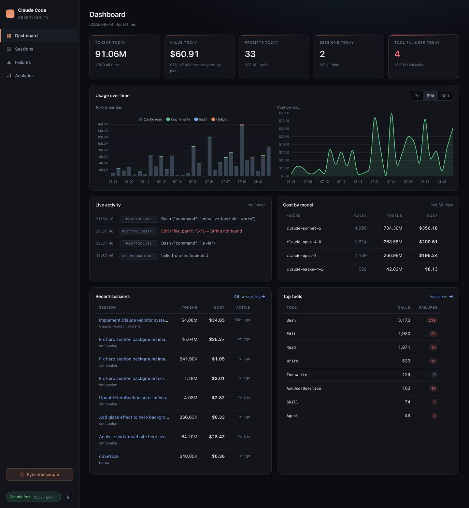
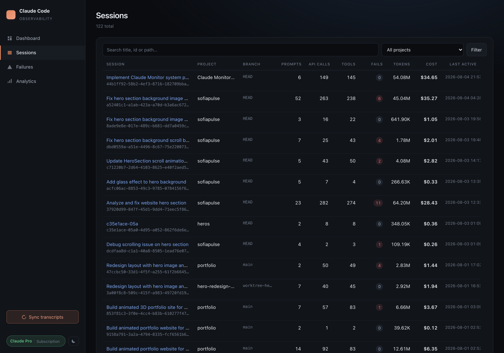
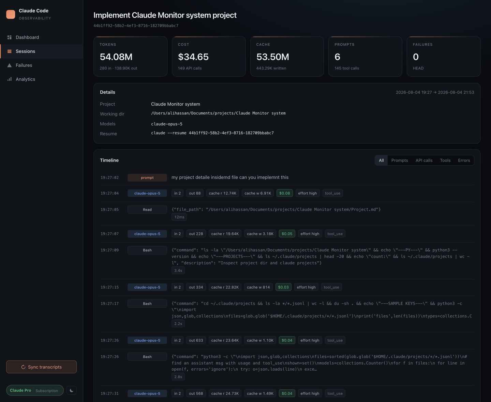
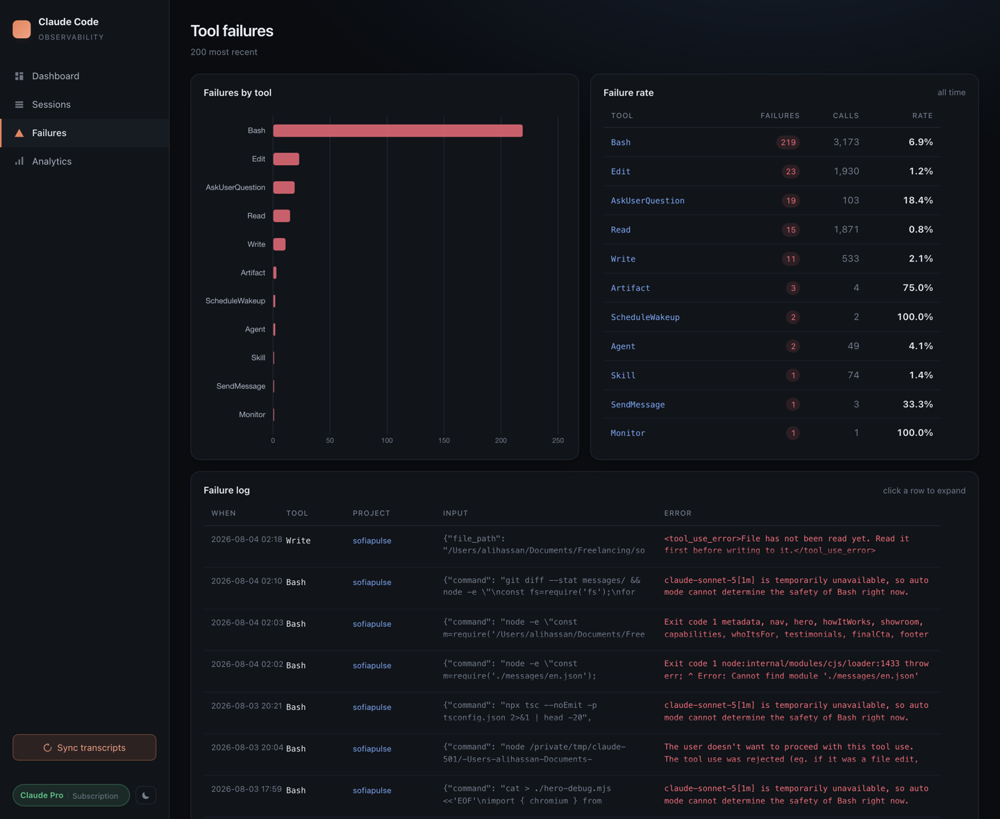
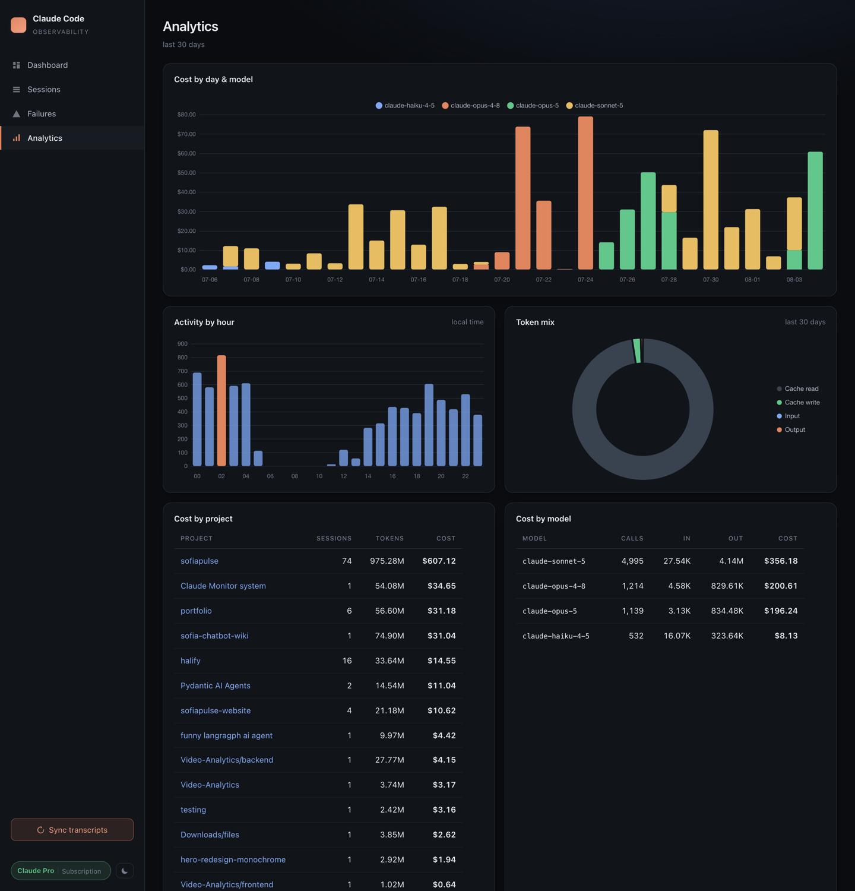
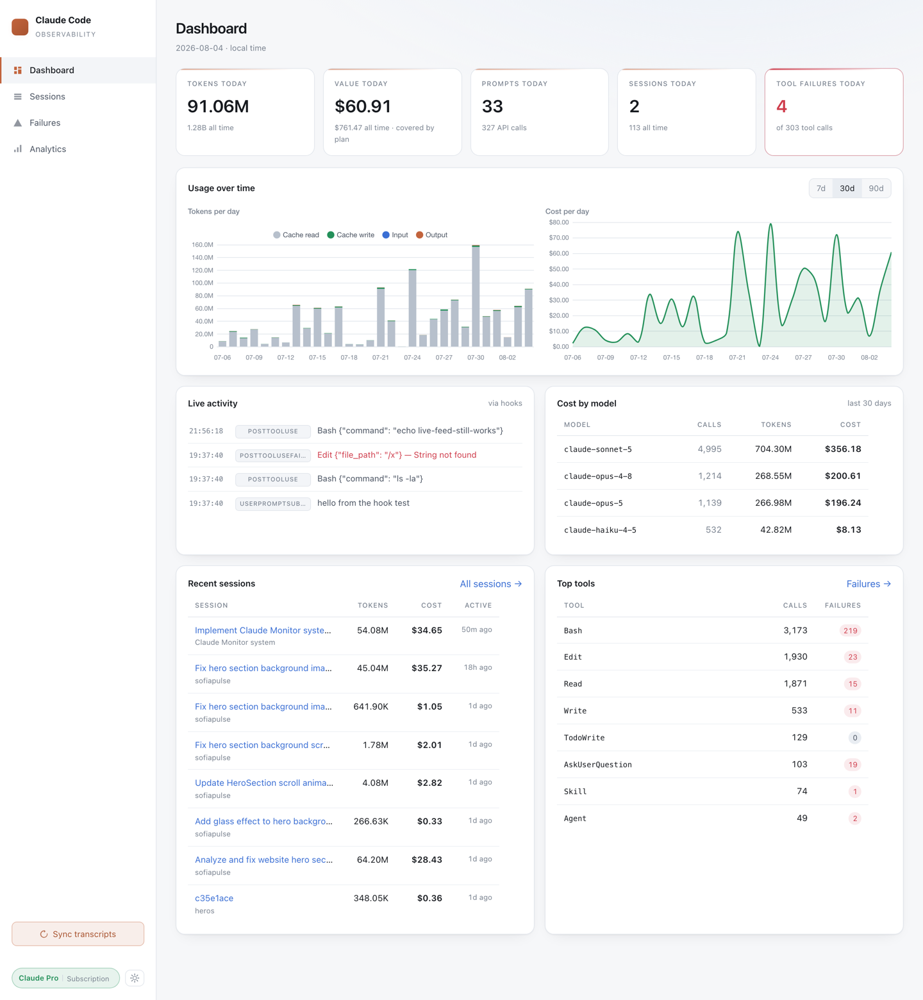

<div align="center">

# Claude Code Dashboard Token Usage, Cost & Analytics Monitor

**A self-hosted observability dashboard for [Claude Code](https://claude.com/claude-code).**
Track token usage, API cost, prompts, sessions, tool calls and failures — parsed directly
from the JSONL transcripts Claude Code already writes to your disk.

[](https://www.python.org/)
[](https://fastapi.tiangolo.com/)
[](https://www.sqlite.org/)
[](#privacy)
[](LICENSE)

[**GitHub**](https://github.com/alihassanml/claude-code-monitor) · [Report an issue](https://github.com/alihassanml/claude-code-monitor/issues)

</div>



---

## Install

### Option A — Claude Code plugin (recommended)

Nothing to clone or run manually — the dashboard starts itself on session start.

```
/plugin marketplace add alihassanml/claude-code-monitor
/plugin install claude-code-monitor@alihassanml
```

First session after install takes ~30s in the background to set up; every session after
that is a single health check. Dashboard opens at **<http://localhost:8787>**.

```bash
claude-monitor status     # running? plus today's tokens, cost and billing mode
claude-monitor open       # open the dashboard in your browser
claude-monitor sync       # re-read transcripts now
claude-monitor logs       # tail the server log
claude-monitor stop|start|restart|where
```

### Option B — Manual install

**Requirements:** Python 3.10+ and an existing Claude Code install.

```bash
git clone https://github.com/alihassanml/claude-code-monitor.git
cd claude-code-monitor

python3 -m venv venv && source venv/bin/activate
pip install -r requirements.txt

python parser.py            # backfill history from your transcripts
uvicorn main:app --reload   # http://localhost:8000
```

Open <http://localhost:8000>. Hit **Sync transcripts** in the sidebar any time to pull in
new sessions, or wire up [live hooks](#live-updates-via-hooks) for real-time updates.

---

## Why this exists

Claude Code gives you `/usage` and `/cost` for the current session, but nothing that answers
the questions you actually care about over time — daily token burn, actual API dollar cost,
which projects and sessions are expensive, which tools fail most, and whether you're on your
Pro/Max plan or silently paying per token. Every answer already lives in
`~/.claude/projects/**/*.jsonl` — this dashboard parses those transcripts into SQLite and
puts a fast, local UI on top. Nothing leaves your machine.

## Features

- 📊 **Token usage analytics** — input, output, cache-read and cache-write tokens, per day, per model, per project
- 💰 **Cost tracking** — editable per-model pricing table with correct cache multipliers
- 🧾 **Billing mode detection** — Pro/Max subscription, API key, gateway, or Bedrock/Vertex, with a warning when a stale API key is silently overriding your plan
- 🗂 **Session explorer** — every session with rollups, searchable and filterable by project
- ⏱ **Session timeline** — prompts, API calls and tool calls, merged chronologically
- ⚠️ **Failure tracking** — failure rate per tool plus a full error log
- 🔴 **Live activity feed** — real-time updates over WebSocket, driven by Claude Code hooks
- 🌗 **Dark & light themes** — follows your OS, toggle persists
- ⚡ **Incremental ingestion** — byte-offset resume, ~20ms for a no-op pass over 120 transcripts
- 🔒 **100% local** — SQLite file on disk, no telemetry, no account, no cloud

**Stack:** FastAPI · Jinja2 · SQLite (stdlib) · Chart.js via CDN. No build step, no npm.

## Screenshots

<table>
<tr>
<td width="50%"><br><em>Sessions — rollups, search, project filter</em></td>
<td width="50%"><br><em>Session timeline — per-call tokens and cost</em></td>
</tr>
<tr>
<td width="50%"><br><em>Failures — rate per tool and full error log</em></td>
<td width="50%"><br><em>Analytics — cost by model, project and hour</em></td>
</tr>
</table>

<details>
<summary><strong>Light theme</strong></summary>



</details>

## Pages & API

| Page | What's on it |
|---|---|
| `/` | Today's tokens, cost, prompts, sessions and failures; 7/30/90-day charts; live feed; recent sessions; top tools |
| `/sessions` | Every session with rollups; filter by project, search by title/id/path |
| `/sessions/{id}` | Merged timeline of prompts, API calls (per-call tokens + cost) and tool calls |
| `/failures` | Failure rate per tool, bar chart, and the full failure log with error text |
| `/analytics` | Stacked cost by day & model, activity by hour, token mix, cost by project, billing mode, pricing table |

The plugin serves these on port **8787**; a manual `uvicorn` run defaults to **8000**.

**JSON API** — every page is backed by a documented endpoint:

```
GET  /api/summary                 today + all-time totals, billing mode, DB stats
GET  /api/usage/daily?days=30     per-day token and cost series
GET  /api/usage/cost?days=30      cost by day×model, by model, by project
GET  /api/usage/hourly?days=30    API calls bucketed by local hour
GET  /api/tools                   tool usage and failure counts
GET  /api/auth                    billing mode + warnings
GET  /api/health                  liveness probe with app identifier
GET  /api/sessions                session list with rollups
GET  /api/sessions/{id}           one session + its full timeline
POST /api/ingest[?rebuild=true]   run the incremental parser
```

## How it works

Claude Code writes one JSONL file per session to
`~/.claude/projects/<project-path>/<session-id>.jsonl`. Each line is one event.

**The duplicate-usage gotcha** — an assistant turn is written as one line per content block
(thinking, text, each tool call), and the same `message.usage` object repeats on every one
of them. A naive parser that sums `usage` per line overcounts tokens by ~1.9×. This dashboard
keys the `messages` table on `message.id` with `INSERT OR IGNORE`, so each API call is
counted exactly once.

**Cost model** — `pricing.py` holds USD-per-1M-token rates per model. Cache tokens are billed
off the input rate at standard multipliers: reads ×0.1, writes ×1.25 (5-min TTL) or ×2.0
(1-hour TTL). Costs reflect what published API rates would charge for that usage — whether
that's an actual bill depends on your billing mode.

**Billing mode detection** — `auth_mode.py` resolves the same precedence Claude Code uses
(API key → gateway token → Bedrock/Vertex → OAuth/subscription → unknown), reading
`~/.claude.json`, `~/.claude/settings.json`, and shell profiles for credential *presence*
only. No credential value is ever read, logged, or returned.

## Live updates via hooks

**Installed as a plugin, this is already done** — [`hooks/hooks.json`](hooks/hooks.json) is
registered automatically. For manual installs, merge the `hooks` block from
[`hooks/settings.json`](hooks/settings.json) into `~/.claude/settings.json`. Claude Code
POSTs each event to the dashboard, which stores it, pushes it to any open browser over `/ws`,
and re-runs the incremental ingest on `Stop` / `SessionEnd`.

> ⚠️ A hook pointing at a port with nothing listening makes Claude Code wait for the timeout
> on every event. Remove the block when the dashboard isn't running.

## Configuration

| Env var | Default | Purpose |
|---|---|---|
| `CLAUDE_PROJECTS_DIR` | `~/.claude/projects` | Where transcripts are read from |
| `CLAUDE_DASHBOARD_DB` | `./claude_dashboard.db` | SQLite file location (plugin overrides this to its data dir) |
| `CLAUDE_MONITOR_PORT` | `8787` | Port the plugin serves on |

The dashboard binds to localhost and **has no authentication** — it renders your full prompt
text, so don't expose it on a shared interface without putting auth in front of it.

<a name="privacy"></a>
## Privacy

Everything stays on your machine:

- **Reads:** `~/.claude/projects/**/*.jsonl` (transcripts), `~/.claude.json` and
  `~/.claude/settings.json` (billing mode), shell profiles (grepped only for credential
  *presence*, never values).
- **Writes:** SQLite database and server log, both under the plugin's data directory
  (`~/.claude/plugins/data/…`) or your working directory for manual installs.
- **Network:** no telemetry, no account, no outbound calls except installing dependencies
  from PyPI and the Chart.js CDN script tag.

## Project structure

```
├── main.py              FastAPI app: pages, JSON API, hook endpoints, WebSocket
├── parser.py            JSONL → SQLite (incremental, offset-resumed)
├── db.py                schema + every query
├── pricing.py           token → USD table (edit rates here)
├── auth_mode.py         subscription / API-key / gateway detection
├── templates/           base, dashboard, sessions, session_detail, failures, analytics
├── static/              style.css, charts.js
├── docs/                screenshots
├── .claude-plugin/      plugin.json + marketplace.json (Claude Code plugin)
├── hooks/hooks.json     plugin hooks (auto-registered)
├── hooks/settings.json  settings fragment for manual installs
├── scripts/             ensure-running.sh — SessionStart auto-start
└── bin/claude-monitor   control CLI, on PATH while the plugin is enabled
```

## Roadmap

- [ ] Budget alerts when daily or monthly spend crosses a threshold
- [ ] CSV / JSON export for external reporting
- [ ] Prompt-length vs cost correlation view

## Contributing

Issues and pull requests are welcome at
[github.com/alihassanml/claude-code-monitor](https://github.com/alihassanml/claude-code-monitor).
The codebase is small and dependency-light on purpose — if you're adding a feature, keeping
it to stdlib + the existing four packages is preferred.

## License

[MIT](LICENSE) — use it, fork it, ship it.
